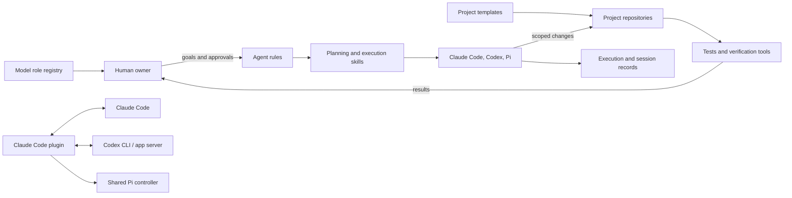

# AI-Coding-System

**A documentation-first governance system for coordinating AI coding agents across software projects.**

This repository collects shared agent rules, planning and execution workflows, reusable skills, project templates, verification tools, and a Claude Code plugin that connects Claude Code with Codex and Pi. It is a personal system in active development—not a turnkey agent platform or a guarantee of code quality.

## Why it exists

AI coding agents can produce useful changes quickly, but work gets difficult to review when agents skip discovery, make broad edits, or leave no durable record of what they tried. This project makes the work more structured: agents discover before changing, people approve scope at defined gates, tasks have observable verification steps, and execution history is retained.

## How it fits together



The repository is primarily guidance and tooling. The governance rules do not automatically enforce every documented gate; agents and maintainers must run and report the specified checks. The included self-check and complexity-budget tool provide limited mechanical checks.

## Repository contents

| Path | Purpose |
|---|---|
| `AGENTS.md`, `AGENTS.planning.md`, `AGENTS.execution.md` | Shared behavior, planning, and execution rules |
| `skills/core/` | Reusable workflows for discovery, specs, tasking, implementation, verification, and documentation |
| `skills/utility/` | Optional support skills |
| `config/models.yaml` | Central model-role and fallback configuration |
| `templates/` | Project rules, documentation, execution-log, and formatting templates |
| `tools/` and `tests/` | Governance self-checks, complexity-budget check, and tests |
| `codex-plugin-cc/` | Claude Code plugin for Codex reviews/delegation and shared Pi-controller commands |
| `docs/` | Specs, plans, audits, operating guides, and execution records |

See [CODEBASE_MAP](docs/ai_context/CODEBASE_MAP.md) and [system overview](docs/human_docs/system_overview.md) for more detail.

## Getting started

This repository does not have a single installer for the governance rules. They are intended to be loaded by the coding-agent tools you use and extended by project-level `AGENTS.md` files.

1. Clone the repository:

   ```bash
   git clone https://github.com/Vedaang-Chopra/AI-Coding-System.git ~/agent-governance
   ```

2. Configure your coding-agent tools to read the relevant rule files. Planning agents use `AGENTS.md` and `AGENTS.planning.md`; Pi execution uses `AGENTS.md` and `AGENTS.execution.md`.
3. For a governed project, start from [`templates/project-AGENTS.md`](templates/project-AGENTS.md), replace its placeholders, and point it to the shared rules. Keep project-specific additions separate from global rules.
4. Follow the human approval gates in the workflow. Do not treat the skills as a substitute for reviewing agent changes.

For the bundled plugin's install and command instructions, see [`codex-plugin-cc/README.md`](codex-plugin-cc/README.md). For Pi setup and operating details, see [`docs/ai_context/pi_agent_tooling_guide.md`](docs/ai_context/pi_agent_tooling_guide.md).

## Verification

From the repository root:

```bash
python3 tools/governance_selfcheck.py
python3 -m pytest tests/ -q
```

The Python tests require `pytest` and `PyYAML`; this repository currently has no root Python dependency manifest. Run them in an isolated environment of your choice.

Run the bundled plugin's Node.js tests from its directory, after setting `PI_MODEL` to the fast-code model configured in `config/models.yaml`:

```bash
cd codex-plugin-cc
export PI_MODEL="<configured-model-id>"
npm test
```

The plugin package declares Node.js `>=18.18.0`. See its README for build prerequisites and plugin installation steps.

## Documentation map

- [Documentation taxonomy](docs/ai_context/DOC_TAXONOMY.md)
- [Codebase map](docs/ai_context/CODEBASE_MAP.md)
- [End-to-end workflow](docs/ai_context/SYSTEM_WORKFLOW_MAP.md)
- [Human system overview](docs/human_docs/system_overview.md)
- [How to run checks and workflows](docs/human_docs/how_to_run.md)
- [How to debug common failures](docs/human_docs/how_to_debug.md)
- [Contributing](CONTRIBUTING.md)
- [Security reporting](SECURITY.md)

## Project status and licensing

The workflow and tooling are evolving. Some enforcement is documented rather than automatic, and the project does not claim measured quality improvements across external teams or repositories.

There is currently **no root-level license for the repository as a whole**. The bundled `codex-plugin-cc/` directory has its own license and notices; those do not automatically license the other repository contents. See [SECURITY.md](SECURITY.md) for reporting guidance and [CONTRIBUTING.md](CONTRIBUTING.md) for contribution expectations.
