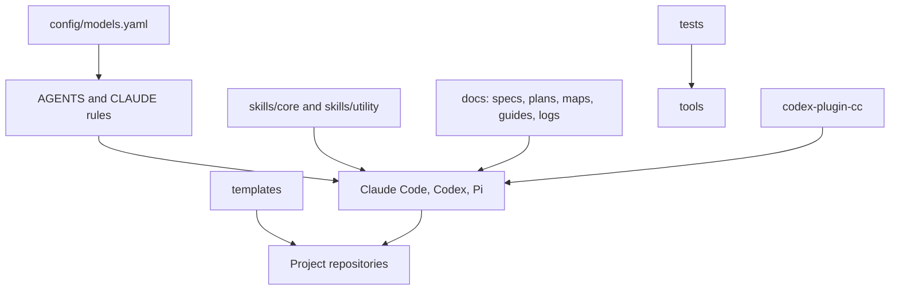

# Codebase Map

**Location:** `docs/ai_context/CODEBASE_MAP.md`
**Updated:** 2026-10-22
**Purpose:** Show the major repository areas, what they own, and how they are used together. Edges below represent usage and coordination, not Python import dependencies.

## Major component map

## Top-level structure

| Path | Responsibility |
|---|---|
| `AGENTS.md` | Global behavior and safety rules |
| `AGENTS.planning.md` | Planning-agent workflow and approval gates |
| `AGENTS.execution.md` | Pi execution-agent workflow |
| `CLAUDE.md` | Claude Code-specific pointer/configuration for the shared rules |
| `CONVENTIONS.md` | Formatting and code-style standards |
| `SYSTEM_OVERVIEW.md` | Machine-oriented system briefing; check linked canonical docs for current detail |
| `skills/core/` | Core agent procedures, including discovery, specification, planning, execution, and verification |
| `skills/utility/` | Optional supporting procedures |
| `templates/` | Reusable project, documentation, log, and formatting templates |
| `config/` | Shared configuration; currently includes `models.yaml` |
| `tools/` | Standalone governance checks |
| `tests/` | Python tests for repository tools and configuration contracts |
| `codex-plugin-cc/` | Node.js Claude Code plugin, Codex integration, Pi controller, and plugin tests |
| `docs/specs/`, `docs/plans/`, `docs/tasks/` | Requirements, technical plans, and executable task definitions |
| `docs/ai_context/` | Agent-facing maps, execution log, and Pi tooling guide |
| `docs/audits/` | Historical audit reports and sampling addenda |
| `docs/human_docs/` | Human-facing operating guides |
| `archive/` | Retired skills and artifacts retained for history |

## Ownership and public entry points

| Area | Owns | Does not own | Entry points |
|---|---|---|---|
| Governance rules | Cross-project agent behavior, safety constraints, and role boundaries | Project-specific implementation logic | `AGENTS.md`, `AGENTS.planning.md`, `AGENTS.execution.md` |
| Skills | Reusable agent procedures and task workflows | Automatic enforcement unless a tool or hook implements it | `skills/core/<name>/SKILL.md` |
| Templates and config | Reusable project artifacts and model-role configuration | Runtime model discovery or secret storage | `templates/`, `config/models.yaml` |
| Governance tools | Static repository checks and diff complexity counting | General-purpose code linting or full policy enforcement | `python3 tools/governance_selfcheck.py`; `python3 tools/check_complexity_budget.py --help` |
| Python tests | Guard and unit tests for governance tools/config | Plugin integration testing | `python3 -m pytest tests/` |
| `codex-plugin-cc` | Claude Code commands for Codex review/delegation, job management, session transfer, and Pi dispatch | The root governance workflow or a hosted Codex service | `codex-plugin-cc/README.md`, `codex-plugin-cc/.agent_control/pi_controller.mjs` |
| Documentation | Human/agent context, decisions, audits, and run history | Replacing the active rule or code source of truth | `README.md`, `docs/` |

## Shared contracts

| Contract | Canonical location | Used by |
|---|---|---|
| Model role aliases and fallback settings | `config/models.yaml` | Agent instructions and Pi controller setup guidance |
| Project-specific rule extension | `templates/project-AGENTS.md` | Projects adopting the shared governance rules |
| Python formatting configuration | `templates/ruff.toml` | Governed Python projects |
| Complexity verdict format | `tools/check_complexity_budget.py` | Checkpoint procedures and task evidence |
| Pi run artifacts | `.agent_runs/` (ignored) | `codex-plugin-cc/.agent_control/pi_controller.mjs` |

## What not to duplicate

- Do not create a second model registry; update `config/models.yaml`.
- Do not restate global rules in a project `AGENTS.md`; add only local overrides.
- Do not copy skill procedure text into task files when a link and precise task instructions suffice.
- Do not treat the Pi controller's own result or the plugin's review as a substitute for independent verification.
- Do not assume the plugin's nested license covers the entire repository.

## Known gaps

- The governance gates are partly procedural; the repository does not implement a universal hook that enforces every rule.
- No root Python dependency manifest is present, although Python tests use `pytest` and `PyYAML`.
- The repository has no root-level license; a license choice for the complete repository remains unresolved.
- The system briefing `SYSTEM_OVERVIEW.md` contains historical counts and should be checked against current files before quoting exact totals.

## Changelog

| Date | Change |
|---|---|
| 2026-10-22 | Added initial map from the tracked repository structure and current entry points. |
