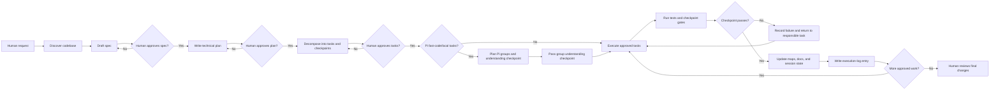

# System Workflow Map

**Location:** `docs/ai_context/SYSTEM_WORKFLOW_MAP.md`
**Updated:** 2026-10-22
**Purpose:** Describe the intended human-gated workflow for work coordinated by this repository.

## End-to-end workflow

## Stage descriptions

| Stage | Primary inputs | Output | Gate/owner |
|---|---|---|---|
| Discover | Human request, current code and docs | Findings, ownership, affected files, existing tests | Agent investigates; human resolves ambiguity |
| Specify | Discovery findings | `docs/specs/NNN_*.md` with scope and acceptance criteria | Human approval required before plan |
| Plan | Approved spec | `docs/plans/NNN_*.md` with architecture, layers, files, risks, validation | Human approval required before task decomposition |
| Decompose | Approved plan | `docs/tasks/NNN_*.md` with tasks and checkpoints | Human approval required before implementation |
| Optional Pi grouping | Approved tasks assigned to Pi | Capability-sized groups and understanding artifacts | Group checkpoint gates subsequent dispatch |
| Execute | Approved task | Focused code/document change | Agent stays within task scope |
| Verify | Task checkpoint and validation commands | Concrete pass/fail results | No next phase until required checks pass |
| Update records | Verified change | Updated maps/docs/session state and execution log | Agent records actual results; no unverified completion claims |
| Review | Diff and validation evidence | Human decision to accept, revise, or stop | Human retains final approval |

## Enforcement boundary

The workflow is a mix of written procedure and mechanical checks. `governance_selfcheck.py` checks a limited set of repository conventions; `check_complexity_budget.py` counts added function/class declarations in a diff range. The skills specify additional checkpoint gates, but the repository does not currently have universal hooks that automatically block every noncompliant action. Follow the documented workflow and report what was actually run.

## Changelog

| Date | Change |
|---|---|
| 2026-10-22 | Added initial workflow map from `AGENTS.md`, role rules, and checkpoint skills. |
