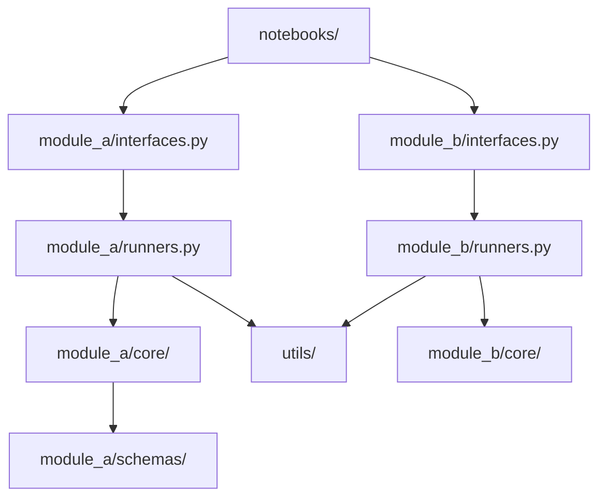

# SKILL: update-codebase-map

## Purpose

`docs/ai_context/CODEBASE_MAP.md` is the single source of truth for module
ownership. Every agent reads it at session start. If it is wrong, every agent
is wrong from the beginning.

This file has two components that must both stay current:
1. **Text tables** — module ownership, public entry points, shared utilities
2. **Mermaid dependency diagram** — visual map of inter-module dependencies

---

## Steps

Open `docs/ai_context/CODEBASE_MAP.md` and update each section affected by
the change. If the file doesn't exist yet, create it with all sections below.

### 1. Mermaid Module Dependency Diagram

Update this first — it forces you to think about what changed structurally.

Rules:
- Nodes are modules or major directories — not individual files.
- Edges show import dependencies (caller → imported).
- If diagram exceeds 12 nodes, break into subsystem diagrams.
- Use `graph TD` for dependency trees.
- This diagram lives at the top of CODEBASE_MAP.md, before the text tables.

### 2. Top-Level Directory Structure
Update if directories were added, removed, or renamed.

### 3. Module Ownership Table
Purpose, what it owns, what it does not own.

| Module | Purpose | Owns | Does NOT own |
|---|---|---|---|
| `module_a/` | ... | ... | ... |

### 4. Public Entry Points Table
Update if `interfaces.py`, `api.py`, or `runners.py` changed.

| Module | File | Public Functions |
|---|---|---|
| `module_a` | `interfaces.py` | `load_inputs()`, `run_pipeline()` |

### 5. Shared Utilities Table
Update if anything moved to or from `utils/`.

### 6. Schemas and Data Contracts Table
Update if schemas were added, moved, or renamed.

| Schema | Location | Used by |
|---|---|---|
| `Record` | `module_a/schemas/record.py` | module_a, module_b |

### 7. What NOT to Duplicate
Update if new shared components were created that agents must not reimplement.

### 8. Module Inventory Table
List all public functions and classes exposed per module.

### 9. Known Gaps / Technical Debt
Update if you introduced or resolved any debt.

### 10. Changelog
Add today's date and a one-line description of what changed.

---

## Checklist

Do not skip sections — check every one, even those that seem unaffected.
Structural changes have ripple effects.

- [ ] Mermaid dependency diagram updated and reflects actual imports.
- [ ] New modules added to ownership table.
- [ ] Removed modules deleted from all tables.
- [ ] Public entry points table reflects current `interfaces.py` / `runners.py`.
- [ ] Shared utilities table updated if `utils/` changed.
- [ ] Schemas table updated if schemas moved or were added.
- [ ] "What NOT to Duplicate" updated if new shared components exist.
- [ ] Module inventory table current.
- [ ] Changelog entry added.

---

## Related Skills

* `SKILL: update-system-diagram` — run together with this for pipeline flow diagrams
* `SKILL: create-module` — triggers this skill
* `SKILL: refactor-module` — triggers this skill
* `SKILL: update-docs` — calls this as part of the full doc update workflow
