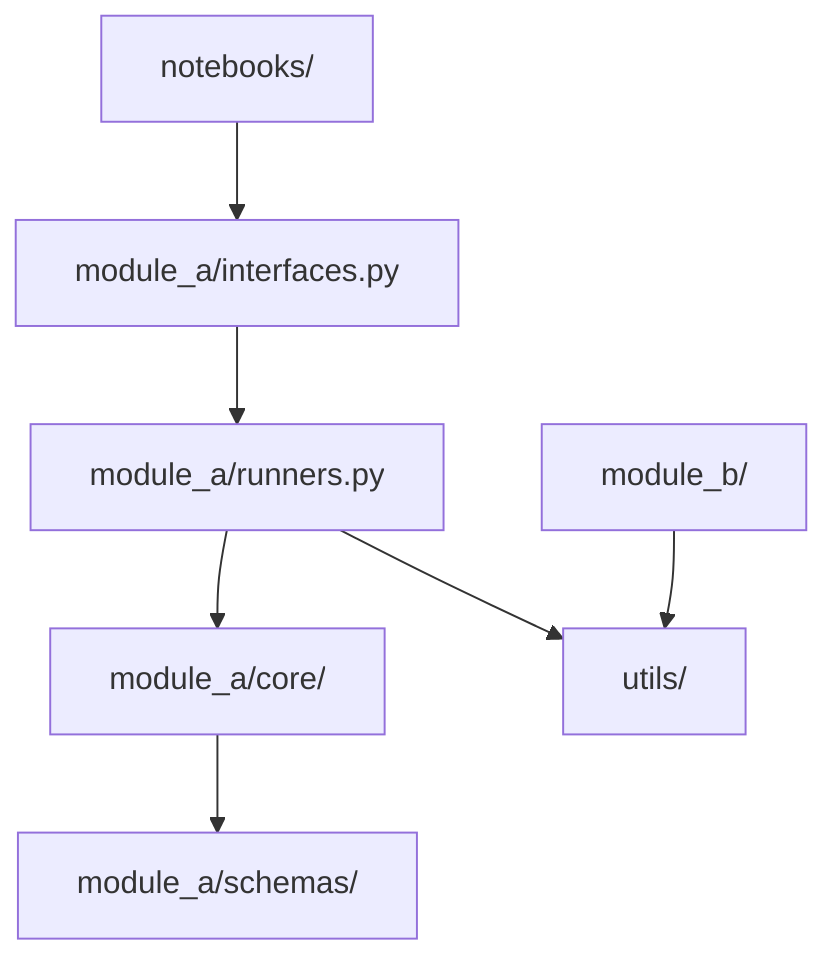
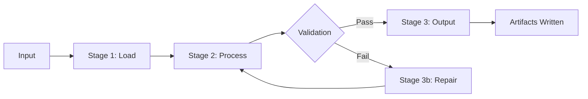
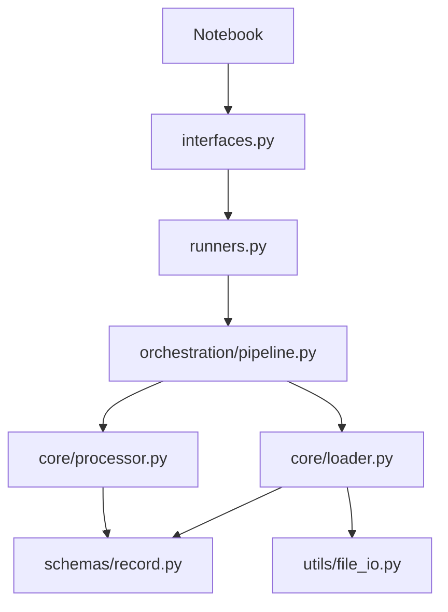

# SKILL: update-system-diagram

## Why Diagrams Matter

A Mermaid diagram in `CODEBASE_MAP.md` lets an agent grasp the full module
dependency structure in a glance. Prose descriptions of the same information
take 5x the tokens and are slower to parse.

Diagrams rot if not kept current. An incorrect diagram is worse than no diagram
— it misdirects agents confidently. Update them in the same change set as the code.

---

## Three Diagram Locations

### 1. `docs/ai_context/CODEBASE_MAP.md` — Module Dependency Graph

Shows which modules depend on which. Update when:
- A module is added or removed
- A new inter-module import is introduced
- A module is renamed or restructured

Rules for this diagram:
- Nodes are modules or major subdirectories, not individual files.
- Edges show import dependencies, not data flow.
- Keep it at the module level — if a diagram has more than 12 nodes, group into subsystems.
- Use `graph TD` (top-down) for dependency trees.

---

### 2. `docs/ai_context/SYSTEM_WORKFLOW_MAP.md` — Pipeline Flowchart

Shows the end-to-end execution flow through the system. Update when:
- A new pipeline stage is added or removed
- The order of stages changes
- A branching condition changes

Rules for this diagram:
- Nodes are pipeline stages, not functions.
- Use `flowchart LR` (left-right) for linear pipelines with branches.
- Label every edge that is not the default/happy path.
- Show loops and retry paths explicitly.
- Decision nodes use `{...}` syntax with labelled outgoing edges.

---

### 3. Module `README.md` — Local Layer Diagram

Shows how data flows through the module's internal layers. Update when:
- A new layer is added to the module
- A new file is added to core/ or orchestration/
- The call order between layers changes

Rules for this diagram:
- Nodes are files or directories, not functions.
- Edges show call direction (caller → callee).
- Keep it local — do not show other modules' internals.
- Use `flowchart TD` (top-down) to mirror the layer hierarchy.

---

## Update Checklist

Run through this after any structural change:

- [ ] Did a module get added, removed, or renamed? → Update module dependency graph in `CODEBASE_MAP.md`
- [ ] Did a new inter-module dependency appear? → Update module dependency graph
- [ ] Did the pipeline add/remove/reorder a stage? → Update `SYSTEM_WORKFLOW_MAP.md`
- [ ] Did a branching condition or retry path change? → Update `SYSTEM_WORKFLOW_MAP.md`
- [ ] Did a module's internal layer structure change? → Update that module's `README.md`
- [ ] Do all diagrams reflect the current code — not the intended design?

---

## Diagram Quality Rules

1. Diagrams must reflect actual code, not design intentions.
2. Keep diagrams minimal. Show structure, not implementation detail.
3. Do not add a node for every file. Group by responsibility.
4. Label edges only when the relationship type is not obvious.
5. If a diagram has more than 15 nodes, break it into subsystem diagrams.
6. No diagram should need a legend — names should be self-explanatory.

---

## Related Skills

* `SKILL: update-codebase-map` — text table updates that accompany the diagram
* `SKILL: write-module-readme` — local layer diagram goes here
* `SKILL: create-module` — new module triggers all three diagram types
* `SKILL: refactor-module` — structural changes trigger all three diagram types
