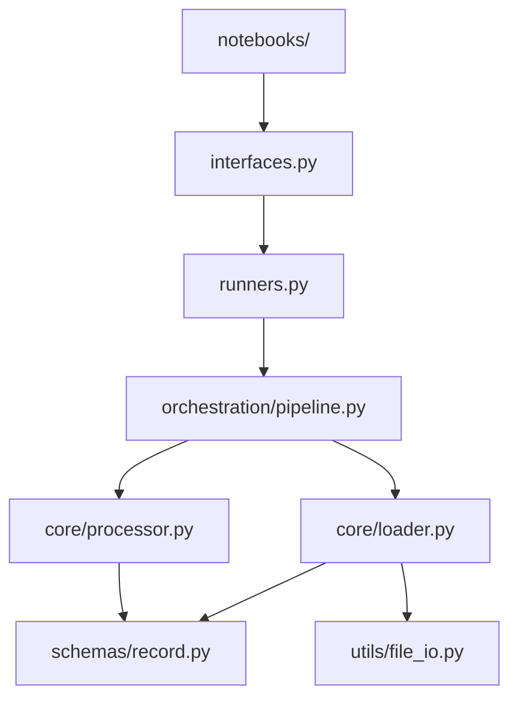

# SKILL: write-module-readme

## Output Location

`<module_name>/README.md`

Keep it under 50 lines of prose. The diagram adds to that limit but is non-negotiable.

---

## Required Format

```markdown
# <module_name>

## Purpose
One sentence: what this module does and what problem it owns.

## What Belongs Here
- Type of code and responsibilities that live in this directory.
- What makes a file belong here vs in another module or utils/.

## What Does NOT Belong Here
- Code that should go elsewhere, with where it should go instead.
- Example: "Shared parsing logic → project-level utils/parsing.py"

## Layer Diagram



## Entry Points

| File | Purpose |
|---|---|
| `interfaces.py` | Public API — what external modules and notebooks import |
| `runners.py` | Workflow orchestration entry point |

## How to Run

At least one of the following:
- **Module:** `python -m <module_name>.runners`
- **Notebook:** `notebooks/<module_name>_inspection.ipynb`
- **Tests:** `pytest tests/test_<module_name>.py -v`

## How to Use

\```python
from <module_name>.interfaces import <function>
result = <function>(inputs)
\```

## Internal Structure

| Directory / File | Responsibility |
|---|---|
| `core/` | Implementation logic and algorithms |
| `schemas/` | Data contracts (dataclasses, Pydantic models) |
| `utils/` | Module-local helpers (not shared outside this module) |
| `orchestration/` | Workflow composition (if module is complex) |

## Dependencies (Internal)

| Module | Why |
|---|---|
| `utils/` | Shared file I/O helpers |
| `<other_module>/` | Provides X which this module uses for Y |
```

---

## Rules

1. The Mermaid layer diagram is required. Do not skip it.
   - Nodes are files or directories, not functions.
   - Edges show call direction (caller → callee).
   - Include every file that matters for understanding flow.
   - Do not show external module internals.

2. The Purpose statement must be one sentence. If you need more, the module
   boundary is unclear.

3. "What Does NOT Belong Here" must be explicit — not "other stuff."
   Name the alternative location for each category.

4. Entry Points table must match the actual current state of `interfaces.py`
   and `runners.py`. Update it when those files change.

5. "How to Run" must include at least one runnable command — not a description
   of what the command would be.

6. Update this file whenever:
   - A new public function is added to `interfaces.py` or `runners.py`
   - The internal directory structure changes
   - The module's purpose or boundaries change

---

## Checklist

- [ ] Purpose is one sentence.
- [ ] Mermaid layer diagram present and accurate.
- [ ] "What Does NOT Belong Here" names alternative locations.
- [ ] Entry points table matches current `interfaces.py` / `runners.py`.
- [ ] At least one runnable command in "How to Run."
- [ ] Internal structure table lists all subdirectories.
- [ ] Dependencies table accurate.

---

## Related Skills

* `SKILL: create-module` — this is always run as part of new module creation
* `SKILL: update-system-diagram` — updates diagrams in both this file and CODEBASE_MAP
* `SKILL: update-codebase-map` — run together after structural changes
