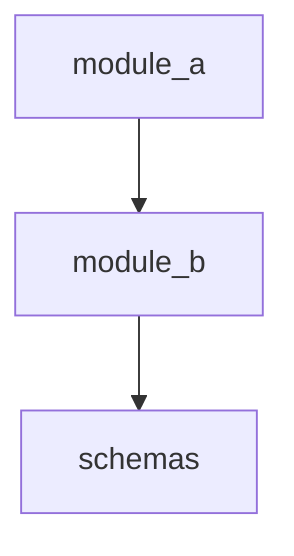

# Codebase Map
# Location: docs/ai_context/CODEBASE_MAP.md
# Updated by: update-codebase-map skill after every structural change

## Module Dependency Graph

## Module Ownership

| Module | Purpose (one sentence) | Primary maintainer | Entry points |
|---|---|---|---|

## Public Entry Points

| Module | File | Public functions |
|---|---|---|

## Shared Utilities

| Utility | Location | Used by |
|---|---|---|

## Schemas

| Schema | Location | Used by |
|---|---|---|

## What NOT to Duplicate

List patterns that already exist and must not be reimplemented:

## Known Gaps

## Changelog

| Date | Change |
|---|---|
