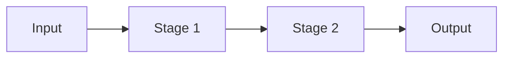

# System Workflow Map
# Location: docs/ai_context/SYSTEM_WORKFLOW_MAP.md
# Updated by: update-system-diagram skill after every pipeline change

## End-to-End Pipeline

## Stage Descriptions

| Stage | Module | Input | Output | Notes |
|---|---|---|---|---|

## Changelog

| Date | Change |
|---|---|
